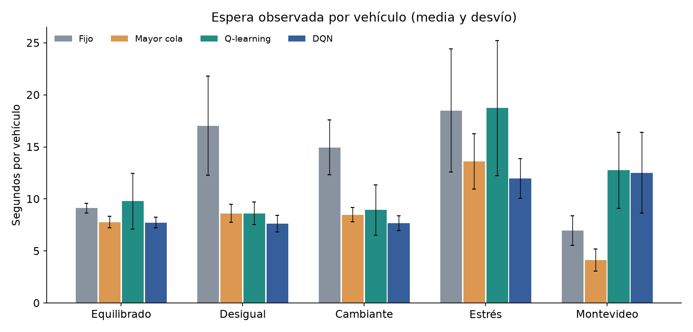
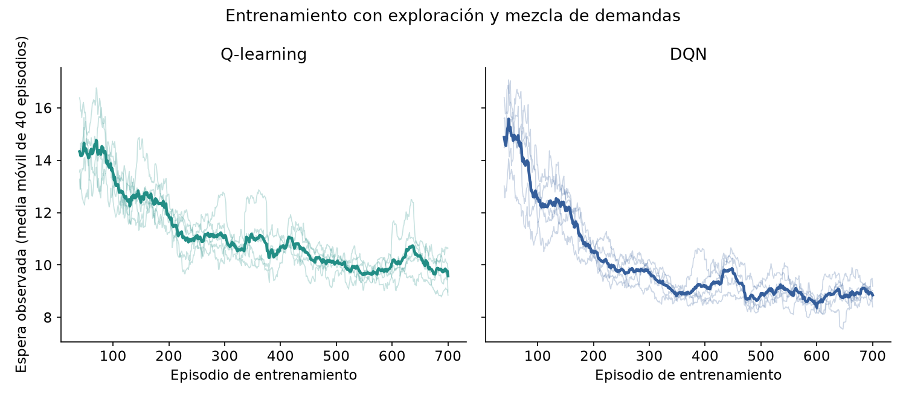

# Control adaptativo de semáforos mediante aprendizaje por refuerzo

Informe grupal de Machine Learning

**Integrantes:** Marcos Devincenzi, Facundo Díaz, Santiago Alba y Domingo Leiva.

**Docente:** Gustavo Vazquez. **Entrega y exposición:** 26 de noviembre de 2026.

## Resumen

Comparamos cuatro estrategias para controlar una intersección simplificada: tiempos fijos, prioridad a la mayor cola, Q-learning tabular y Deep Q-Network (DQN). Construimos un simulador discreto en Python y evaluamos cada estrategia con las mismas llegadas de vehículos y fase inicial. Además de condiciones sintéticas controladas, incorporamos perfiles derivados de mediciones oficiales del Centro de Gestión de Movilidad de Montevideo.

Entrenamos cinco agentes de cada algoritmo durante 700 episodios y evaluamos 30 episodios por escenario. DQN reduce la espera observada frente al semáforo fijo en los cuatro escenarios sintéticos. Sin embargo, en los perfiles de Montevideo la regla de mayor cola obtiene 4.13 segundos por vehículo, frente a 6.96 del fijo, 12.74 de Q-learning y 12.50 de DQN. Por lo tanto, los resultados no justifican recomendar un agente aprendido para el caso local representado.

La contribución del trabajo es comparar las políticas con un protocolo reproducible y estudiar cómo cambia su desempeño con la demanda. Las colas, esperas y acciones provienen de la simulación. No realizamos una evaluación de campo ni una reconstrucción completa de una intersección real.

## Problema y objetivo

Un controlador de tiempos fijos mantiene su programación aunque cambien las colas. Un agente de aprendizaje por refuerzo puede ajustar sus decisiones según lo que observa, pero requiere entrenamiento y puede fallar fuera de las condiciones aprendidas.

Nuestra pregunta es si aprender una política reduce la espera frente a dos alternativas simples y qué costo tiene pasar de una tabla de valores a una red neuronal. La hipótesis es que la adaptación puede aportar cuando la demanda es desigual o cambia durante el episodio. No suponemos que una política aprendida deba superar a una regla en todas las condiciones.

El alcance comprende dos accesos que compiten por el verde, sin giros, peatones ni coordinación con otros cruces. El producto es un proyecto ejecutable en Python, acompañado de datos, modelos, resultados y una demostración.

<!-- pagebreak -->

## Motivación y antecedentes en Montevideo

Elegimos aprendizaje por refuerzo como un tema nuevo para el grupo. El proyecto requiere estudiar sus fundamentos, implementarlos y explicarlos. La idea del semáforo nos interesó por una experiencia cotidiana: esperar en una intersección y preguntarnos si las fases podrían ajustarse mejor al tránsito. Nuestra percepción sobre posibles dificultades de coordinación motiva la pregunta; no constituye una evaluación técnica de la red municipal.

### Gestión semafórica existente

La Intendencia describe al Centro de Gestión de Movilidad como una infraestructura de gestión del tránsito en tiempo real con semáforos centralizables y cámaras de conteo y monitoreo [7].

Una comunicación municipal del 16 de agosto de 2024 documenta la implementación de Full Adaptive en nueve intersecciones de Tres Cruces, con actualización del flujo cada tres segundos y ajuste de los tiempos según la demanda [8]. La publicación no identifica Q-learning ni DQN. Esa información describe un antecedente histórico y no establece toda la cobertura actual.

### Aporte del proyecto

La originalidad que encontramos para el trabajo está en construir una aplicación propia y estudiar su comportamiento: un simulador legible, perfiles derivados de datos locales y comparación reproducible de estrategias. Reconocemos que el control semafórico adaptativo tiene antecedentes en Montevideo y que su existencia debe formar parte del marco del problema.

Nuestro experimento compara cuatro políticas del simulador. No disponemos de la implementación ni de resultados operativos de Full Adaptive para evaluarlo con el mismo protocolo. En consecuencia, una mejora frente al fijo simulado no demuestra superioridad frente al sistema municipal. El objetivo académico es aprender y explicar cuándo cada estrategia aporta dentro de las condiciones representadas.

<!-- pagebreak -->

## Marco teórico

### Aprendizaje por refuerzo y proceso de decisión

Un agente elige acciones, observa consecuencias y recibe recompensas. El objetivo es maximizar el retorno descontado: G_t = r_t + gamma r_(t+1) + gamma² r_(t+2) + ... El descuento gamma controla el peso de las consecuencias futuras.

El modelo de referencia es un proceso de decisión de Markov, definido por estados, acciones, transiciones, recompensas y descuento. Una política determina qué acción tomar. La función Q(s,a) estima el retorno de ejecutar una acción y continuar con una política. En este proyecto las transiciones se ejecutan en un simulador, sin que el agente conozca una fórmula para anticiparlas.

### Q-learning tabular

Q-learning actualiza el valor de una pareja estado-acción a partir de la recompensa y una estimación del mejor valor siguiente [1]:

Q(s,a) = Q(s,a) + alpha [r + gamma max Q(s',a') - Q(s,a)]

Al terminar el episodio el término futuro vale cero. Usamos exploración epsilon-greedy: con probabilidad epsilon elegimos una acción aleatoria y, en los demás casos, la de mayor valor. La representación tabular requiere agrupar las observaciones en estados discretos. Esa agregación reduce el tamaño de la tabla y también pierde información.

### Deep Q-Network

DQN representa Q mediante una red neuronal que devuelve un valor por acción. Para estabilizar el entrenamiento utiliza un buffer de experiencias y una red objetivo [2]. Muestreamos transiciones del buffer en minibatches y calculamos un objetivo con la copia de la red. Actualizamos la red principal mediante gradiente y sincronizamos la copia periódicamente.

Nuestra implementación usa pérdida Huber y Adam. La primera reduce el efecto de errores temporales grandes; el segundo ajusta los parámetros de la red. DQN puede compartir información entre observaciones parecidas, pero agrega decisiones de arquitectura, optimización y entrenamiento. Una mayor capacidad no garantiza una mejor política.

### Relación con el caso

El semáforo es el agente. Sus acciones alteran las colas que observará después, por lo que se trata de un problema secuencial. No contamos con etiquetas de la acción correcta. El entorno recompensa la reducción del tiempo acumulado en cola.

No invocamos una garantía de convergencia óptima para este experimento: usamos un presupuesto finito, discretización y una demanda parcialmente observada. Las tasas de llegada no están en la observación y la agregación de estados pierde información. Las conclusiones son empíricas para las políticas y escenarios evaluados.

<!-- pagebreak -->

## Simulación y formulación del problema

Cada episodio dura 600 segundos y comienza con colas vacías. Sorteamos la fase inicial con una semilla independiente de las llegadas. Pregeneramos las llegadas por segundo antes de elegir acciones, de modo que dos controladores puedan enfrentar exactamente el mismo tránsito.

| Parámetro | Valor |
|---|---|
| Paso interno | 1 segundo |
| Intervalo de decisión | 5 segundos |
| Verde mínimo | 10 segundos |
| Límite superior de verde | 60 segundos |
| Transición sin circulación | 3 segundos |
| Capacidad de salida por acceso activo | 1 vehículo por segundo |
| Capacidad de almacenamiento de las colas | Sin límite |

En cada segundo agregamos vehículos, retiramos los habilitados y sumamos un segundo de espera a quienes permanecen en cola. Atendemos por orden de llegada. Solo puede circular un acceso por vez. Las restricciones se aplican en el entorno y son iguales para todos los controladores.

La transición ocupa parte del intervalo de decisión: después de cambiar, el primer verde efectivo dura dos segundos dentro de ese bloque. Por eso algunos verdes terminan en 12, 17 o 22 segundos. Forzamos un cambio si mantener el siguiente bloque superaría el límite de 60 segundos. El máximo de verde evita mantener indefinidamente una fase, pero no garantiza una espera máxima individual bajo congestión.

### Observaciones y acciones

La observación tiene cinco componentes: tamaño de ambas colas, fase vigente, edad de la fase y tiempo relativo del episodio. Dividimos las colas por 40, la edad por 60 y el tiempo por 600. Estas escalas son constantes definidas por el proyecto, no parámetros aprendidos con los datos de prueba. No recortamos las colas de DQN a un máximo.

Q-learning agrupa cada cola con bordes 0, 2, 5, 10, 20 y 40 vehículos. Agrupa la edad con bordes 9, 19, 29, 39, 49 y 59 segundos, y el tiempo en tres partes. La tabla contiene 2.058 estados agregados y dos valores por estado. DQN recibe las cinco variables normalizadas sin esa discretización.

La acción 0 mantiene la fase y la 1 solicita un cambio. Una solicitud anterior al verde mínimo no produce cambio. Ambos agentes tienen las mismas acciones y restricciones.

### Recompensa

La recompensa de una decisión es menos la suma de las colas durante sus segundos internos, dividida por 100. Penaliza el tiempo total de espera. La transición ya genera costo al impedir salidas, por lo que no añadimos una penalización arbitraria por cambiar. La evaluación final mide esperas sin descuento, mientras que el entrenamiento utiliza gamma = 0.97 por decisión. Son objetivos relacionados, pero no idénticos.

<!-- pagebreak -->

## Datos oficiales de Montevideo

Utilizamos el conjunto “Conteo vehicular en las principales avenidas de Montevideo”, publicado por la Intendencia de Montevideo, Departamento de Movilidad, Centro de Gestión de Movilidad [3]. El catálogo describe mediciones por carril cada cinco minutos mediante analítica de video.

Descargamos el recurso de enero de 2026 el 12 de noviembre de 2026. Su ZIP contiene 8.425.612 registros. Conservamos 44.578 filas originales de dos aproximaciones al entorno de Bulevar Artigas y Rivera, sin alterar sus valores. La selección ocupa mucho menos que el archivo mensual completo y queda incluida en el repositorio.

| Acceso | Ubicación descrita por el CSV | Detectores |
|---|---|---|
| A | Bv Artigas, desde Palmar hacia Rivera | 701411, 701412, 701413 |
| B | Rivera, desde Ponce hacia Bv Artigas | 701404, 701405 |

Sumamos los carriles por acceso y timestamp. Requerimos los cinco detectores presentes y conservamos horarios de 06:00 a 21:55. Dividimos el campo publicado volumen_hora entre 3.600 para obtener intensidades en vehículos por segundo. Si hubiera duplicados por detector e instante, los promediaríamos antes de sumar; no aparecieron en la selección utilizada.

| Partición temporal | Fechas de enero | Registros derivados |
|---|---|---|
| Entrenamiento | 1 al 20 | 3.835 |
| Validación | 21 al 25 | 954 |
| Prueba | 26 al 31 | 1.152 |

Formamos ventanas de dos registros consecutivos separados por cinco minutos. Cada ventana representa dos bloques de 300 segundos, correspondientes a los intervalos previos a sus timestamps. Generamos llegadas de Poisson con las intensidades de cada bloque. No comprimimos un día completo dentro de diez minutos.

### Diferencia entre medición y simulación

Las mediciones son reales, pero la secuencia individual de llegadas, las colas y las esperas son simuladas. Los sensores registran circulación observada, no la demanda que existiría bajo otra política. La geometría completa del cruce y los demás movimientos tampoco se reconstruyen.

El recurso contiene volumen_hora, sin la columna volumen que menciona la descripción general. El TXT y la página también difieren al describir si el valor resume la última hora o extrapola cinco minutos. Respetamos la unidad horaria publicada, sin intentar recuperar conteos exactos. Esta incertidumbre y las tasas bajas resultantes condicionan la interpretación local.

La nota de origen, URL de descarga, licencia de Datos Abiertos - Uruguay, metadatos originales y hash SHA-256 están en data/README.md y data/auditoria_datos.json. La selección y el procesamiento son modificaciones del proyecto, no del proveedor.

<!-- pagebreak -->

## Diseño experimental

### Controladores de referencia

El controlador fijo usa la misma duración para ambos accesos. Elegimos entre 10, 15, 20, 25, 30, 40, 50 y 60 segundos con 20 semillas por escenario de validación. El criterio es la media de espera observada sobre equilibrado, desigual, cambiante y perfiles locales de validación. La duración seleccionada es 15 segundos. Es una referencia ajustada, aunque no un plan vial optimizado con tiempos distintos por acceso.

La regla de mayor cola solicita un cambio cuando el otro acceso tiene más vehículos. En empate mantiene la fase. Ambas estrategias pasan por las restricciones del simulador.

### Entrenamiento de los agentes

Cada algoritmo usa cinco semillas, de 0 a 4. Cada agente entrena 700 episodios de 120 decisiones: 84.000 interacciones. Ambos reciben la misma secuencia de escenarios y llegadas por semilla. La mezcla incluye equilibrado, desigual, cambiante y ventanas locales de entrenamiento, con probabilidades iguales.

| Parámetro | Q-learning | DQN |
|---|---|---|
| Descuento gamma | 0.97 | 0.97 |
| Tasa de aprendizaje | 0.12 | 0.0005, Adam |
| Exploración | De 1.00 a 0.05 | De 1.00 a 0.05 |
| Reducción de exploración | Primer 75% del entrenamiento | Primer 75% del entrenamiento |
| Representación | Tabla de valores | Red 5-64-64-2, ReLU |
| Replay y minibatch | No utiliza | 30.000 transiciones, batch 64 |
| Comienzo de actualizaciones | Desde la primera transición | Desde 1.000 transiciones |
| Frecuencia de actualización | Cada decisión | Cada 4 decisiones |
| Red objetivo | No utiliza | Sincronización cada 250 updates |

Usamos los parámetros declarados, sin una búsqueda exhaustiva de hiperparámetros. Guardamos la política final de cada entrenamiento. No seleccionamos el mejor agente mirando la prueba ni volvimos a ajustar después de observar esos resultados. Los modelos se ejecutan en CPU.

### Escenarios y evaluación final

Las intensidades sintéticas son 0.23/0.23 veh/s para equilibrado, 0.40/0.10 para desigual y esas tasas intercambiadas a los 300 segundos para cambiante. Estrés usa 0.42/0.32 y se reserva para evaluación. El caso Montevideo usa ventanas de las fechas de prueba.

Evaluamos 30 semillas de tránsito por escenario. Cada agente entrenado enfrenta esas 30 realizaciones sin exploración. Hay 150 ejecuciones por algoritmo aprendido y escenario, y 30 por referencia. No interpretamos las 150 como observaciones de tránsito independientes.

<!-- pagebreak -->

## Resultados de espera observada

Definimos la espera observada media como la suma de todos los segundos en cola dividida por los vehículos que llegaron. Incluye a quienes siguen esperando al final. Para ellos, la espera está censurada por el horizonte: no equivale a su espera final hasta cruzar.

La tabla muestra media y desvío estándar en segundos por vehículo. Para los agentes el desvío combina variación entre episodios y semillas de entrenamiento. Es una descripción de dispersión, no un intervalo de confianza de la media.

| Escenario | Fijo | Mayor cola | Q-learning | DQN |
|---|---|---|---|---|
| Equilibrado | 9.11 ± 0.47 | 7.78 ± 0.57 | 9.78 ± 2.69 | 7.73 ± 0.51 |
| Desigual | 17.03 ± 4.76 | 8.61 ± 0.87 | 8.62 ± 1.08 | 7.63 ± 0.79 |
| Cambiante | 14.95 ± 2.64 | 8.48 ± 0.69 | 8.93 ± 2.41 | 7.66 ± 0.70 |
| Estrés | 18.49 ± 5.92 | 13.62 ± 2.65 | 18.74 ± 6.48 | 11.97 ± 1.89 |
| Montevideo | 6.96 ± 1.42 | 4.13 ± 1.05 | 12.74 ± 3.66 | 12.50 ± 3.87 |

DQN obtiene la menor media entre los cuatro controladores en los cuatro escenarios sintéticos. Frente al fijo reduce aproximadamente 15.2% en equilibrado, 55.2% en desigual, 48.7% en cambiante y 35.3% en estrés. La diferencia frente a mayor cola es pequeña en equilibrado y mayor en estrés. Estos porcentajes comparan las medias del experimento, no mejoras garantizadas fuera de él.

Q-learning mejora frente al fijo en desigual y cambiante, pero empeora en equilibrado y prácticamente empata en estrés. Su desempeño depende del régimen de demanda y presenta más variabilidad. La discretización y la visita finita a estados son explicaciones posibles, no causas aisladas experimentalmente.

En Montevideo la regla de mayor cola obtiene la menor espera. Los dos agentes duplican aproximadamente la espera del fijo. Por tanto, aumentar la capacidad de representación no resuelve el caso local bajo este entrenamiento. Recomendamos la regla como referencia para ese régimen simulado y conservamos el resultado negativo del aprendizaje.

<!-- pagebreak -->

## Esperas altas y vehículos pendientes

También medimos el percentil 95 de las esperas observadas. Incluye las esperas acumuladas de los pendientes y hereda su censura. La tabla informa el promedio de los percentiles por ejecución; no es el percentil de todos los vehículos mezclados.

| Escenario | Fijo | Mayor cola | Q-learning | DQN |
|---|---|---|---|---|
| Equilibrado | 22.14 | 17.63 | 28.65 | 18.19 |
| Desigual | 36.77 | 18.43 | 23.66 | 18.98 |
| Cambiante | 34.12 | 18.35 | 25.99 | 19.43 |
| Estrés | 41.82 | 27.01 | 50.61 | 24.67 |
| Montevideo | 20.45 | 12.34 | 44.61 | 45.25 |

En estrés, DQN combina una media menor con un percentil 95 de 24.67 segundos, frente a 41.82 del fijo y 50.61 de Q-learning. En Montevideo, mayor cola obtiene 12.34 segundos frente a 45.25 de DQN. El agente no solo tiene una media peor en ese caso: también concentra esperas altas más grandes.

La cantidad media de vehículos pendientes al finalizar complementa la espera para evitar ocultar colas sin atender:

| Escenario | Fijo | Mayor cola | Q-learning | DQN |
|---|---|---|---|---|
| Equilibrado | 4.00 | 3.13 | 3.69 | 2.79 |
| Desigual | 10.37 | 4.83 | 4.04 | 3.86 |
| Cambiante | 8.20 | 4.67 | 5.07 | 3.74 |
| Estrés | 17.87 | 11.53 | 15.62 | 9.29 |
| Montevideo | 0.10 | 0.03 | 0.56 | 0.58 |

En estrés quedan 9.29 vehículos con DQN frente a 17.87 con el fijo. En Montevideo las cantidades son pequeñas para todos, pero Q-learning y DQN dejan más pendientes que las referencias. La baja cantidad de vehículos locales no vuelve irrelevante su espera: los episodios son de baja demanda bajo la conversión adoptada.

Los CSV también incluyen vehículos que cruzaron, máxima cola y cantidad de cambios. No reducimos la decisión a una única cifra de recompensa.

<!-- pagebreak -->

## Aprendizaje e incertidumbre

La figura usa una media móvil de 40 episodios, líneas finas por semilla y una línea gruesa promedio. Son episodios con exploración y demandas distintas: no se deben leer como una curva de evaluación controlada ni como evidencia de mejora monótona. La comparación final sin exploración aparece en las tablas anteriores.

Para comparar con el fijo, primero promediamos los cinco agentes de cada algoritmo por semilla de tránsito. Después calculamos diferencias pareadas y un bootstrap de 2.000 remuestreos de esas semillas. Evitamos repetir cinco veces un mismo episodio del fijo como si aportara nueva información.

Los intervalos son condicionales a las cinco políticas entrenadas. No capturan completamente la incertidumbre de repetir el entrenamiento y, en Montevideo, las ventanas pueden solaparse y compartir condiciones del mismo día. Por eso no los interpretamos como intervalos de una población de días independientes ni como pruebas definitivas de significación.

En demanda cambiante la diferencia media de DQN frente al fijo es -7.29 segundos, con intervalo descriptivo de -8.10 a -6.49. En Montevideo es +5.54 segundos, de +4.65 a +6.34. El signo negativo indica menor espera y el positivo, mayor espera. Las diferencias completas están en results/paired_differences.csv.

### Costo de entrenamiento

Ambos algoritmos reciben igual cantidad de interacciones, pero no igual costo computacional. La red agrega inferencias, memoria de replay y actualizaciones por gradiente. Los tiempos medidos y versiones se guardan por modelo en models/*.json. Son mediciones del equipo de ejecución y no una promesa de duración en cualquier computadora.

<!-- pagebreak -->

## Discusión y limitaciones

La adaptación sí aporta en demanda desigual y cambiante, pero una regla simple también captura gran parte de esa mejora. DQN resulta competitivo en los escenarios sintéticos y generaliza al escenario de estrés reservado. El experimento no aísla si su ventaja proviene de la red o de recibir colas continuas: la comparación también cambia la discretización. Una ablación con la misma representación permitiría separar esos efectos.

En los perfiles locales los agentes realizan menos cambios que mayor cola y presentan esperas mayores. Una hipótesis es que la mezcla de entrenamiento, dominada en magnitud de recompensa por escenarios de más tránsito, no prioriza suficientemente reducir pequeñas colas locales. Otra es que el descuento favorece mantener cuando cambiar cuesta tres segundos. No demostramos causalmente esas hipótesis. Para investigarlas harían falta experimentos nuevos con datos de desarrollo y una nueva prueba reservada.

### Decisión metodológica más frágil

La decisión más frágil es usar la suma de volumen_hora de los sensores como tasa exógena de llegada. Son mediciones de circulación bajo semáforos existentes, no demanda independiente de sus acciones. Además, las descripciones del recurso no coinciden completamente y los perfiles derivados son de baja demanda. Si la interpretación de la unidad o la cobertura fuera incorrecta, cambiarían la intensidad simulada y las cifras de espera de Montevideo, incluida la recomendación del controlador.

La evidencia adicional necesaria es confirmar la semántica del campo con el proveedor, contrastar conteos crudos por intervalo y medir llegadas, colas y salidas en el cruce. No multiplicamos arbitrariamente por doce para obtener un resultado más conveniente.

### Otros límites concretos

La descarga de un vehículo por segundo representa una capacidad agregada supuesta, aunque los datos suman varios carriles. No está calibrada con tiempos reales de descarga. Empezar con colas vacías favorece episodios cortos sin congestión acumulada previa. No modelamos bloqueo aguas abajo, giros, peatones ni propagación entre cruces.

El semáforo fijo comparte tiempos entre accesos y podría mejorar con un plan asimétrico. No agotamos ajustes de hiperparámetros de Q-learning ni DQN. Cinco semillas permiten observar variabilidad, pero no caracterizar todas las políticas posibles. El conjunto local corresponde a enero, por lo que no representa todo el año.

## Conclusión

Con el presupuesto y simulador utilizados, DQN reduce la espera frente al control fijo en condiciones sintéticas y Q-learning lo hace en dos de esos escenarios. En los perfiles derivados de Montevideo gana la regla de mayor cola. La elección de controlador depende del régimen de demanda, la representación y el costo de entrenamiento.

El resultado respalda usar aprendizaje por refuerzo como alternativa a comparar, sin asumir superioridad automática. Antes de una aplicación vial sería necesario validar la interpretación de los datos, calibrar el simulador y ampliar la evaluación con observaciones reales de espera.

<!-- pagebreak -->

## Reproducibilidad y entrega

El repositorio contiene archivos Python, sin notebooks. Las rutas se resuelven desde la carpeta del proyecto y no dependen del nombre de usuario. Los CSV reducidos y los diez modelos se incluyen para ejecutar la comparación sin descargar nuevamente el archivo mensual.

El flujo completo es: instalar requirements.txt, ejecutar las pruebas con unittest, entrenar con scripts.train, evaluar con scripts.evaluate --select-baseline, generar gráficos con scripts.plots y crear la demostración con scripts.demo. El README incluye los comandos exactos.

El archivo configs/experiment.json declara semillas, episodios e hiperparámetros. Los logs de entrenamiento, selección del fijo y evaluación quedan en results/. Cada modelo tiene una ficha JSON con versiones y tiempo de entrenamiento. Los modelos guardados sirven para inferencia, no para reanudar exactamente el optimizador o el replay.

Las ocho comprobaciones separadas verifican conservación de vehículos y esperas, transición sin circulación, verde mínimo y máximo, independencia de llegadas respecto de las acciones, episodios vacíos, separación temporal, actualización terminal de Q-learning y actualización/guardado de DQN.

La demo HTML reproduce trazas calculadas por Python. Permite pausar y recorrer un episodio compartido por los cuatro controladores. No entrena un agente dentro del navegador. La animación GIF proporciona un respaldo sin dependencias de ejecución.

## Referencias

[1] Watkins, C. J. C. H. y Dayan, P. (1992). Q-learning. Machine Learning, 8, 279-292. https://www.gatsby.ucl.ac.uk/~dayan/papers/cjch.pdf

[2] Mnih, V. et al. (2015). Human-level control through deep reinforcement learning. Nature, 518, 529-533. https://doi.org/10.1038/nature14236

[3] Intendencia de Montevideo, Departamento de Movilidad, CGM. Conteo vehicular en las principales avenidas de Montevideo. Recurso enero de 2026, consulta 12/11/2026. https://catalogodatos.gub.uy/dataset/conteo-vehicular-en-las-principales-avenidas-de-montevideo

[4] Agencia de Gobierno Electrónico y Sociedad de la Información y del Conocimiento. Licencia de Datos Abiertos - Uruguay, versión 0.1. Enlace al texto oficial en data/README.md.

[5] NumPy. Documentación del generador aleatorio. https://numpy.org/doc/stable/reference/random/generator.html

[6] PyTorch. Documentación de redes neuronales, Adam y SmoothL1Loss. https://docs.pytorch.org/docs/stable/index.html

[7] Intendencia de Montevideo. Centro de Gestión de Movilidad. Consulta 12/11/2026. https://montevideo.gub.uy/tipo/area-tematica/movilidad/gestion-de-la-movilidad/centro-de-gestion-de-movilidad

[8] Intendencia de Montevideo. Implementación del Proyecto Tránsito Adaptativo. Publicado 16/08/2024, actualizado 19/08/2024. Consulta 12/11/2026. https://montevideo.gub.uy/noticias/movilidad-y-transporte/implementacion-del-proyecto-transito-adaptativo
